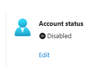
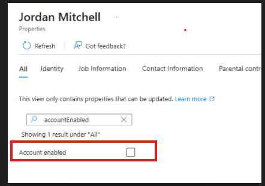
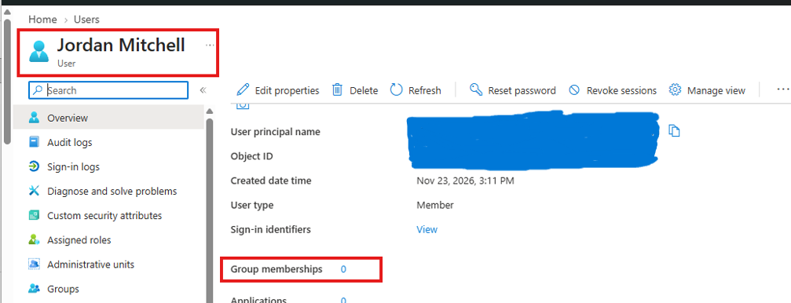
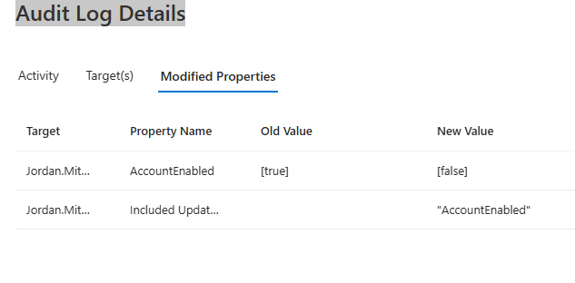
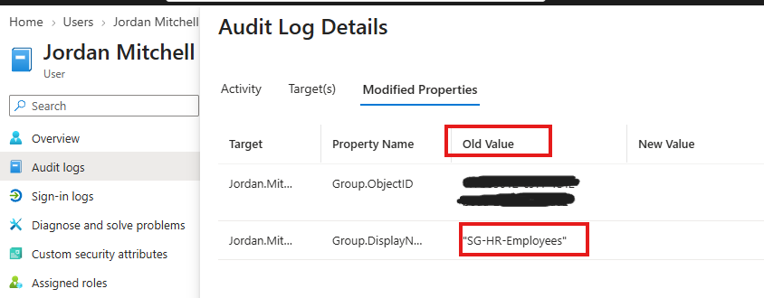
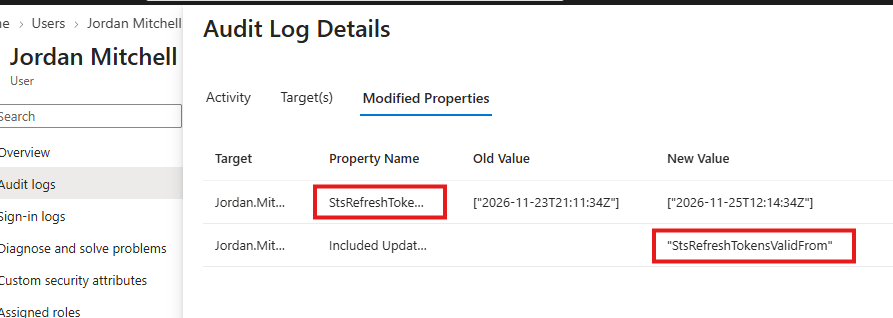

# Microsoft Entra ID – Identity Lifecycle Management Lab

## Project Overview
This hands-on IAM lab demonstrates identity lifecycle management using a personal Microsoft Entra ID environment.

## Lab Environment
- Microsoft Entra ID Free
- Cloud-based test user accounts
- Security groups
- Microsoft Entra admin center

## Phase 1 – Joiner (Completed)
- Created a test user named Jordan Mitchell.
- Assigned employee ID LAB001.
- Assigned the Finance department and Financial Analyst job title.
- Created Finance and HR security groups.
- Added the user to SG-Finance-Employees.
- Verified group membership.

## Phase 2 – Mover (Completed)
- Simulated an employee transfer from Finance to HR.
- Updated the department and job title to HR Specialist.
- Removed Finance security group membership.
- Added the user to SG-HR-Employees.
- Verified that the previous group membership was removed.

## Phase 3 – Leaver (Completed)
- Simulated an HR-authorized employee termination.
- Disabled the user account in Microsoft Entra ID.
- Successfully revoked sign-in sessions.
- Removed membership from SG-HR-Employees.
- Verified that no group memberships remained.
- Confirmed that the account status was Disabled.
- Reviewed Microsoft Entra audit logs to validate
  successful deprovisioning activities.

## Audit and Compliance Verification
- Verified successful account disablement.
- Verified session revocation.
- Verified security group membership removal.
- Reviewed timestamps and success statuses in audit logs.
- Retained the disabled account for auditing purposes.

## Security Concepts
- Identity lifecycle management (JML)
- User provisioning and deprovisioning
- Role-based access control (RBAC) concepts
- Principle of least privilege
- Identity governance

## Project Status
Completed

## Certification
CompTIA Security+ (SY0-701)

## Lab Evidence and Screenshots

### Account Disablement
Verified that the terminated user's account was disabled.

### Security Group Membership Removal
Verified that the user had no remaining group memberships.

### Audit Log Verification
Reviewed successful account disablement, session revocation, and group membership removal activities.

## Detailed Entra ID Audit Log Investigation

Performed additional audit log analysis to independently verify the effectiveness of the employee offboarding process.

### Account Status Verification

Confirmed that the test user's account remained disabled following offboarding.

### Group Membership Verification

Verified that the test user had zero remaining security group memberships.

### Account Disablement Audit Analysis

Reviewed the Modified Properties tab in Microsoft Entra ID audit logs.

- Property: AccountEnabled
- Old Value: True
- New Value: False
- Result: Successful account disablement

### Security Group Removal Audit Analysis

Verified the removal of SG-HR-Employees by reviewing the previous group display name in the audit logs.

### Session Revocation Audit Analysis

Identified the StsRefreshTokensValidFrom property change following session revocation.

- Verified the refresh token validity timestamp was updated.
- Confirmed that previously issued refresh tokens were invalidated.
- Recognized that existing access tokens may remain valid until expiration or enforcement of revocation.

## Security and Compliance Takeaways

- Account disablement alone is not a complete offboarding process.
- Session revocation and security group removal are important deprovisioning controls.
- Audit logs provide evidence of administrative actions.
- Independent verification helps identify incomplete offboarding.
- Accurate documentation supports accountability and audit readiness.
- Personal account information and unnecessary identifiers should be redacted before publishing evidence.

## Final Project Outcome

Successfully completed the Joiner, Mover, and Leaver identity lifecycle exercises, including administrative actions, access verification, audit log analysis, and security documentation in a personal Microsoft Entra ID lab environment.
